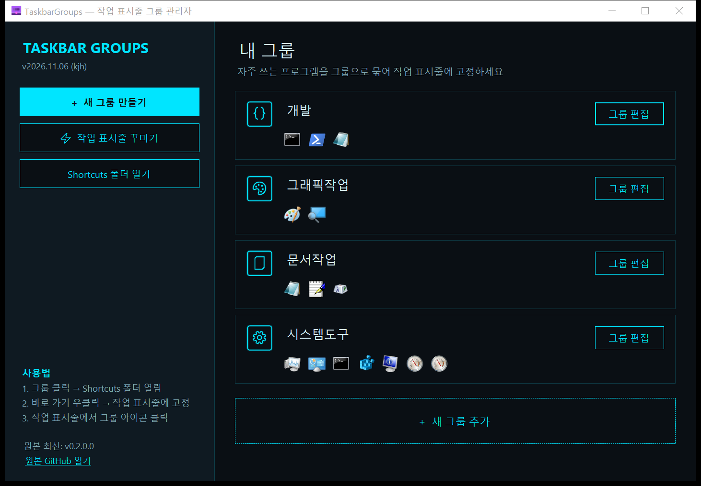
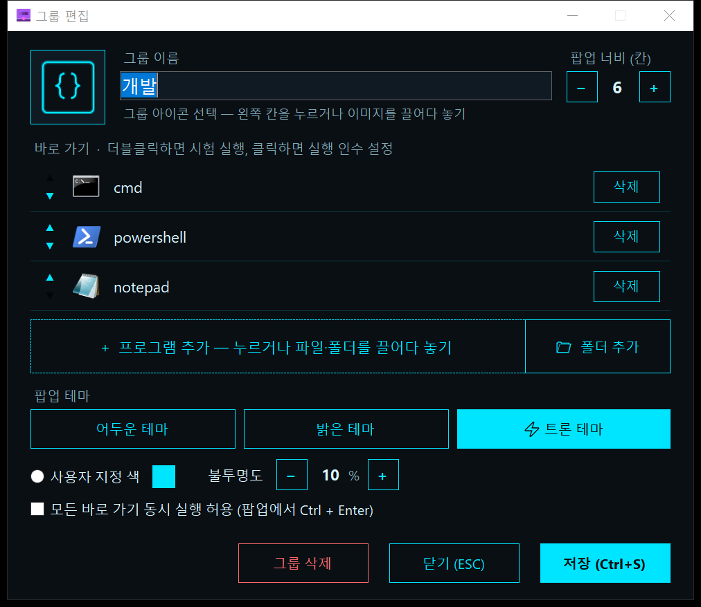
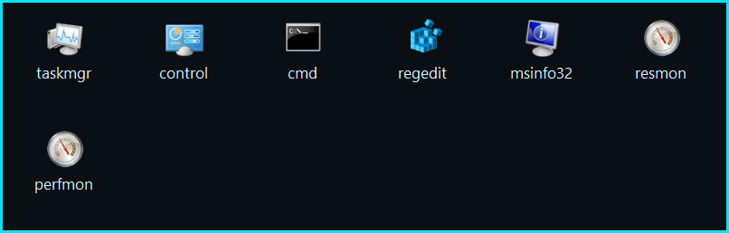
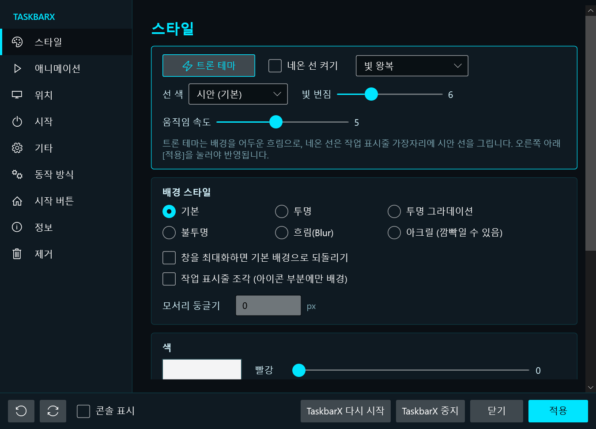

# TaskbarGroups 트론 한국어판 (taskbar-groups-tron-ko)

자주 쓰는 프로그램을 **그룹으로 묶어 작업 표시줄에 고정**하는 Windows 도구입니다.
[TaskbarGroups](https://github.com/tjackenpacken/taskbar-groups)를 **한국어로 바꾸고**, 영화 *TRON: Legacy* 느낌의 **트론 테마**로 다시 꾸몄습니다.
작업 표시줄을 꾸미는 [TaskbarX](https://github.com/ChrisAndriessen/TaskbarX)도 함께 들어 있습니다. TaskbarX에는 작업 표시줄 위를 달리는 **네온 선 애니메이션**을 넣었습니다.

## 화면

| 그룹 편집 | 작업 표시줄 팝업 |
|---|---|
|  |  |

| 작업 표시줄 꾸미기 (TaskbarX) |
|---|
|  |

## 기능

### TaskbarGroups (그룹 관리자)
- **전부 한국어**: 버튼, 안내, 오류 메시지를 모두 한국어로 바꿨습니다. 그룹 이름도 한글로 지을 수 있습니다(예: `문서작업`, `게임`).
- **트론 테마**: 검정 바탕(#0A0F14)에 네온 시안(#00E5FF)을 씁니다. 팝업에는 2px 네온 테두리가 있고, 마우스를 올리면 아이콘이 빛납니다.
- **팝업 테마 선택**: 어두운 테마, 밝은 테마, ⚡ 트론 테마, 사용자 지정 색 중에서 고르고 불투명도도 정할 수 있습니다.
- **팝업에 이름 표시**: 아이콘 아래에 프로그램 이름이 두 줄까지 나옵니다. 글자색은 팝업 바탕색에 맞춰 바뀝니다.
- **그룹 안의 그룹**: 팝업에서 다른 그룹을 열어도 항상 작업 표시줄 바로 위에 뜹니다(아래 "전체 그룹" 참고).
- **고해상도 화면 대응**: Windows 배율이 125%, 150%여도 창이 잘리거나 버튼이 겹치지 않습니다.
- **폴더 바로 가기**: 프로그램뿐 아니라 폴더도 넣을 수 있습니다("📁 폴더 추가" 버튼을 누르거나 끌어다 놓기).
- **시험 실행**: 그룹 편집 창에서 항목을 더블클릭하면 그 프로그램이 바로 실행되어 잘 등록됐는지 확인할 수 있습니다.
- **단축키**: 그룹 편집 창에서 `Ctrl + S`는 저장, `ESC`는 닫기입니다.
- **트레이 아이콘**: 창의 X를 누르면 꺼지지 않고 트레이로 숨습니다. 트레이 아이콘을 더블클릭하면 다시 열리고, 우클릭 메뉴에서 새 그룹 만들기, 작업 표시줄 꾸미기, 종료를 고를 수 있습니다.
- **삭제된 프로그램 표시**: 그룹에 넣은 프로그램이 지워져도 오류 창 대신 '없음' 아이콘을 보여 줍니다.

### TaskbarX (작업 표시줄 꾸미기)
- **⚡ 트론 테마 버튼**: 누르면 작업 표시줄이 흑요석색 반투명으로 바뀝니다.
- **네온 선**: 작업 표시줄 윗변에 빛나는 선을 그립니다. 테마는 3가지입니다.
  - **빛 왕복**: 빛이 왼쪽에서 오른쪽, 다시 오른쪽에서 왼쪽으로 오갑니다.
  - **고정 네온**: 움직이지 않는 선입니다.
  - **트론 오토바이**: 라이트 사이클(오토바이)이 달리고, 지나간 자리에 빛 벽이 생깁니다.
- **선 색**: 시안, 주황, 빨강, 초록, 보라, 흰색 중에서 고릅니다.
- **빛 번짐**: 0(없음)부터 20(크게)까지 조절합니다.
- **움직임 속도**: 1(아주 느리게)부터 10(아주 빠르게)까지 조절합니다.
- 선 바깥은 투명하고 클릭이 통과하므로 다른 창을 막지 않습니다. 전체 화면 게임이나 영상을 볼 때는 자동으로 숨습니다.
- 초당 30번 그려서 컴퓨터 부담을 줄였습니다.
- **선택 기능: 영상 배경 자동 멈춤**: [Lively Wallpaper](https://github.com/rocksdanister/lively)로 영상 바탕화면을 쓰는 경우, 네온 선을 켜 두면 프로그램 창이 열려 있을 때 영상이 자동으로 멈춥니다. 창을 모두 최소화하면 다시 재생됩니다. Lively를 쓰지 않으면 아무 일도 하지 않습니다.
- 메뉴와 설명을 모두 한국어로 바꿨습니다.

## 설치

### 방법 1: 내려받아 바로 쓰기 (추천)
1. [Releases](../../releases)에서 최신 버전의 `TaskbarGroups-tron-ko-v….zip`을 내려받습니다.
2. 원하는 폴더에 압축을 풉니다(예: `C:\Tools\TaskbarGroups`).
3. `TaskbarGroups.exe`를 실행합니다.

> Windows 10/11, .NET Framework 4.7.2 이상이 필요합니다. Windows 10 최신 버전에는 기본으로 들어 있습니다.
> 인터넷에서 받은 파일이라 처음 실행할 때 "Windows의 PC 보호" 창이 뜰 수 있습니다. 그럴 때는 **추가 정보 → 실행**을 누르세요.

### 방법 2: 직접 빌드하기
Visual Studio 2019 이상(.NET 데스크톱 개발)을 설치한 뒤, 폴더에서 `build.bat`을 더블클릭하세요.
NuGet 패키지 복원, TaskbarGroups 빌드, TaskbarX 빌드와 합치기까지 한 번에 합니다. 결과는 `main\bin\Release` 폴더에 생깁니다.

## 사용법

### 그룹 만들고 작업 표시줄에 고정하기
1. `TaskbarGroups.exe`를 실행하고 **"+ 새 그룹 만들기"**를 누릅니다.
2. 그룹 이름을 정하고, 아이콘을 고르고, 프로그램이나 폴더를 추가한 뒤 **저장**합니다.
3. 저장하면 **Shortcuts 폴더**를 열지 물어봅니다. 열린 폴더에서 그룹 바로 가기를 우클릭하고 **"작업 표시줄에 고정"**을 누릅니다.
4. 작업 표시줄의 그룹 아이콘을 누르면 프로그램 목록 팝업이 뜹니다.

### 여러 그룹을 아이콘 하나로 모으기 ("전체 그룹")
그룹이 많으면 작업 표시줄이 복잡해집니다. 이럴 때는 그룹들을 다시 하나의 그룹에 넣으면 됩니다.
1. Shortcuts 폴더 안에 하위 폴더(예: `바로가기`)를 만들고, 각 그룹의 바로 가기(`.lnk`)를 그 안으로 옮깁니다.
2. 새 그룹(예: `전체 그룹`)을 만들고, **"+ 프로그램 추가"**로 그 하위 폴더의 그룹 바로 가기들을 넣어 저장합니다.
3. 작업 표시줄에는 `전체 그룹` 하나만 고정합니다. 누르면 그룹 아이콘들이 뜨고, 하나를 누르면 그 그룹의 프로그램 목록이 뜹니다.

> 그룹 바로 가기를 옮긴 뒤에는 위치를 다시 바꾸지 마세요. 바꾸면 `전체 그룹`에서 찾지 못합니다.

### 작업 표시줄 꾸미기
TaskbarGroups 메인 창이나 트레이 메뉴에서 **"⚡ 작업 표시줄 꾸미기"**를 누릅니다.
**스타일** 탭에서 트론 테마, 네온 선, 선 색, 빛 번짐, 속도를 고른 뒤 **적용**을 누르세요.
네온 선을 끄려면 "네온 선 켜기"의 체크를 풀고 다시 **적용**하거나, **TaskbarX 중지**를 누릅니다.

## 원작자와 라이선스

이 프로젝트는 아래 두 오픈소스 프로그램을 고쳐 만들었습니다. 원작자분들께 감사드립니다.

- **TaskbarGroups**: © 2020 Jack Schierbeck, [tjackenpacken/taskbar-groups](https://github.com/tjackenpacken/taskbar-groups), MIT 라이선스. [LICENSE](LICENSE)
- **TaskbarX**: © 2021 Chris Andriessen, [ChrisAndriessen/TaskbarX](https://github.com/ChrisAndriessen/TaskbarX), MIT 라이선스. [TaskbarX/LICENSE](TaskbarX/LICENSE)

고친 부분(한국어화, 트론 테마, 배율 대응, 네온 선 등)도 같은 **MIT 라이선스**로 공개합니다. 자유롭게 쓰고, 고치고, 다시 나눠도 됩니다. 다만 원작자의 저작권 표시와 라이선스 파일은 남겨 주세요.

TRON은 Disney의 상표입니다. 이 프로젝트는 영화의 분위기를 참고한 팬 테마일 뿐이며, Disney와는 관계가 없습니다.
